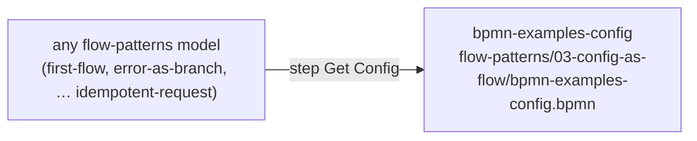
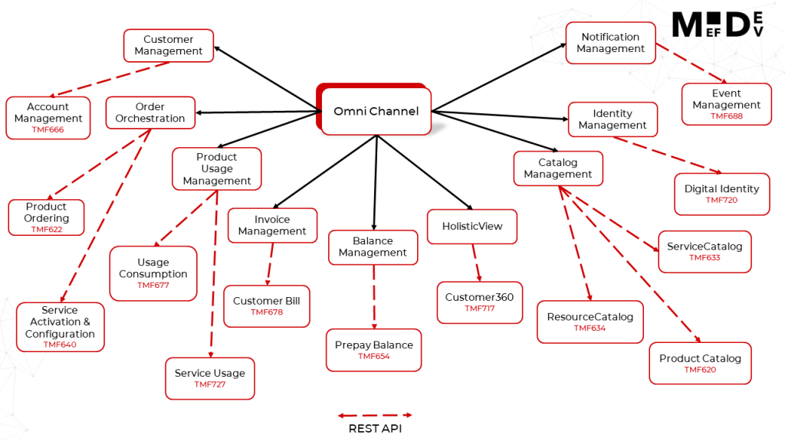

# bpmn-examples

BPMN models (Flows) that run on the MEF.DEV platform. Each `.bpmn` file can be
imported into the MEF.DEV BPMN designer, compiled and started.

How BPMN Low-Code works on the platform:
[BPMN Low-Code overview](https://platform.mef.dev/bpmn_lowcode/bpmn_lowcode_overview.md).

## What is in this repository

| Folder | Contents |
|---|---|
| [flow-patterns](flow-patterns/) | Teaching models in ten groups, one problem per group: typed input and output, errors as a branch with HTTP status and text in the caller's language, configuration in a separate Flow, paging with Multi Instance and `Content-Range`, events, streaming, triggers, AI requests, files, idempotent requests with the distributed cache. **Start here.** |
| [tmforum-apis](tmforum-apis/) | 30 Flows that implement TM Forum Open API operations, one Flow per operation, with the OpenAPI specifications and Postman collections next to them. They run against the database of the BSS behind the API. |
| [3gpp-apis](3gpp-apis/) | The 3GPP Rf rating function: OpenAPI specification and a Postman collection. No Flows. |

Every model in `flow-patterns` has a `<name>.spec.json` file next to it: the
model's input and its example, steps and their comments, outcomes.

## Run an example

1. Create a **tenant** library named `bpmn_examples`.
2. Import `flow-patterns/03-config-as-flow/bpmn-examples-config.bpmn` into it
   and compile it. Every `flow-patterns` model reads its settings from this
   Flow through its first step, `Get Config`.
3. Import the model you want into the same library and compile it. A model is
   imported under its file name.
4. Start it with the example input. You find it in a comment next to the start
   event and in the README of the group, together with the response you should
   get.

Details: [flow-patterns → Before you start](flow-patterns/README.md#before-you-start)
and the full diagram, [which model depends on which](flow-patterns/README.md#which-model-depends-on-which).

## TM Forum Open APIs

| API | Folder | Flows |
|---|---|---|
| TMF620 Product Catalog Management | [TMF620_Product_Catalog_Management](tmforum-apis/TMF620_Product_Catalog_Management/) | Get ProductOffering |
| TMF622 Product Ordering | [TMF622_Product_Ordering](tmforum-apis/TMF622_Product_Ordering/) | Get, Post, Put ProductOrder; Post CancelProductOrder |
| TMF622 Product Ordering | [TMF622_CancelProductOrder](tmforum-apis/TMF622_CancelProductOrder/) | Post CancelProductOrder |
| TMF622 Product Ordering | [TMF622_Monitor](tmforum-apis/TMF622_Monitor/) | Get Monitor |
| TMF640 Service Activation and Configuration | [TMF640_Service_Activation_and_Configuration](tmforum-apis/TMF640_Service_Activation_and_Configuration/) | Get, Post, Put, Patch Service |
| TMF653 Service Test Management | [TMF653_Service_Test_Management](tmforum-apis/TMF653_Service_Test_Management/) | Post ServiceTest |
| TMF654 Prepay Balance Management | [TMF654_PrepayBalance_Management](tmforum-apis/TMF654_PrepayBalance_Management/) | Get AccumulatedBalance |
| TMF666 Account Management | [TMF666_Account_Management](tmforum-apis/TMF666_Account_Management/) | Get, Post, Put BillingAccount |
| TMF677 Usage Consumption Management | [TMF677_Usage_Consumption_Management](tmforum-apis/TMF677_Usage_Consumption_Management/) | Get, Post QueryUsageConsumption |
| TMF678 Customer Bill Management | [TMF678_Customer_Bill_Management](tmforum-apis/TMF678_Customer_Bill_Management/) | BillingCycle; Get BillingCycle; Get AppliedCustomerBillingRate |
| TMF688 Event Management | [TMF688_Event_Management](tmforum-apis/TMF688_Event_Management/) | Get Hub; Get, Post, Put, Delete Topic; Get Topic Event |
| TMF724 Incident Management | [TMF724_Incident_Management](tmforum-apis/TMF724_Incident_Management/) | Post diagnoseIncident |
| TMF727 Service Usage Management | [TMF727_Service_Usage_Management](tmforum-apis/TMF727_Service_Usage_Management/) | Get ServiceUsage |

## Links

- [BPMN Low-Code overview](https://platform.mef.dev/bpmn_lowcode/bpmn_lowcode_overview.md)
- [MEF.DEV platform documentation](https://platform.mef.dev/plugin_basics/introduction.md)
- [Run the platform with Docker Compose](https://github.com/mef-dev/docker)
- [Run the platform on Kubernetes](https://github.com/mef-dev/k8s)
- [Support channel on Telegram](https://t.me/mef_dev_support)

## License

[MIT](LICENSE)
