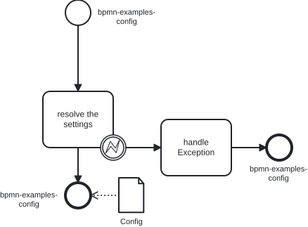
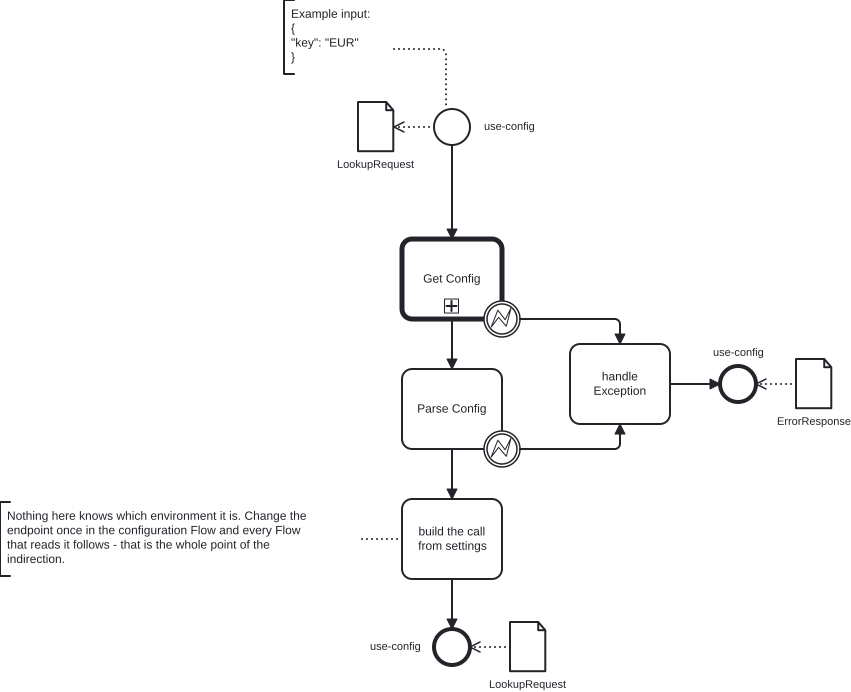

# 03 · Configuration as a separate Flow

Settings live in one Flow; every other Flow asks it for them and never learns
which environment it runs in.

| File | Flow | Needed? | What it is |
|---|---|---|---|
| `bpmn-examples-config.bpmn` | `bpmn-examples-config` | **required** — every model in this repository calls it | the configuration Flow: answers with the settings |
| `use-config.bpmn` | `use-config` | optional | the smallest consumer: only the two steps every other example starts with (`Get Config`, `Parse Config`) and one step that reads a setting. Import it to see the pattern on its own; no other model depends on it |

## What this example demonstrates

| Capability | Where to look |
|---|---|
| A Flow whose whole job is to answer with settings | `bpmn-examples-config.bpmn` |
| Call Activity by name (mnemonic reference) | `Get Config` in `use-config.bpmn` |
| `activities://bpmn-mnemo/<libType>/<libName>/<flowName>/#latest` | the `ExternalDefinitionLink` parameter of `Get Config` |
| An external type instead of a copied one | `types://external/ConfigActivity/Config` |
| Casting the answer once and storing it | `Parse Config`, which fills `Parameters.config` |
| A native C# type as a declared type | the `Config` class in `bpmn-examples-config.bpmn` |

## The two models





```
bpmn-examples-config.bpmn:  start → resolve the settings → end
                                       ↓ (on error)
                                handle Exception → end

use-config.bpmn:            start → Get Config → Parse Config → build the call from settings → end
                                         ↓             ↓ (on error)
                                         └─────────────┴──→ handle Exception → end
```

`Get Config` is a Call Activity: it runs the Flow `bpmn-examples-config` (the
file `bpmn-examples-config.bpmn` from this folder, in the tenant library
`bpmn_examples`) and hands back its answer. `Parse Config` casts that answer
once, into `Parameters.config`, so every later step reads a typed object rather
than loose JSON.

One Flow, several names:

| Name | Where you see it |
|---|---|
| `bpmn-examples-config` | the Flow, its file, the reference in `Get Config` |
| `ConfigActivity` | the alias each consumer gives that Flow in `UsedLibs` |
| `Config` | the settings type, declared in `bpmn-examples-config` |
| `ExternalConfig` | the same type inside a consumer: `types://external/ConfigActivity/Config` |

## Types it declares

| Type | Where | Kind | How it is used |
|---|---|---|---|
| `Config` | `bpmn-examples-config.bpmn` | inner, **native C#** | the settings themselves: `ratesUrl`, `listUrl`, `login`, `password`, `pageSize`, `language` (the installation's language for error texts), `cacheSeconds` (how long an answer stays in the distributed cache). Declared here and nowhere else |
| `ExternalConfig` | `use-config.bpmn` | external → `types://external/ConfigActivity/Config` | the same type, reached by reference |
| `LookupRequest` | `use-config.bpmn` | inner, JSON Schema | the process boundary of the consumer: in, `key` is a currency code; out, `key` holds the URL built from it |
| `ErrorResponse` | both | inner, JSON Schema | the shape of a failure |

**This is the mechanism worth understanding.** The alias in `UsedLibs` points at
a Flow; `types://external/<alias>/<Type>` then reaches inside that Flow for a
type it declares. No copy is made. If `Config` grows a field, consumers see it
after a recompile; if it loses one, they fail to compile instead of failing at
run time.

## What you should get back

The configuration Flow answers with the settings:

```
{}   →   HTTP 200
{"ratesUrl":"https://api.frankfurter.dev/v1",
 "listUrl":"https://jsonplaceholder.typicode.com/posts",
 "login":"","password":"","pageSize":10,"language":"en","cacheSeconds":300}
```

It is meant to be called by other Flows through a Call Activity, not by outside
callers: it returns every setting it holds. `login` and `password` are empty
here; a real deployment keeps credentials out of any answer that leaves the
platform.

The consumer builds a URL from them and answers with the same type,
`LookupRequest`, its `key` now holding the URL:

```
{ "key": "EUR" }   →   HTTP 200
{"key":"https://api.frankfurter.dev/v1/latest?base=EUR"}
```

The consumer never contains the host name. Point the configuration Flow
somewhere else, and this reply changes without the consumer being touched.

## Why it is built this way

**The reference is by name, not by number.** `activities://bpmn-mnemo/tenant/…`
resolves by *name* and follows `#latest`. The numeric form
`activities://bpmn/<libType>/<libId>/<flowId>/<version>` pins identifiers that
exist in exactly one installation and resolves nowhere else.

**The library type is `tenant`, not `personal`.** A personal library is visible
only to the account that created it, so a `personal/…` reference in a shared
Flow works for its author and for nobody else.

**The settings are one type, not five parameters.** Adding a field means
editing one class, not hunting for every Flow that reads settings.

## Where newcomers stumble

- **The configuration Flow must exist before a consumer compiles.** Otherwise
  the consumer fails with `cant resolve class name for uri
  'activities://bpmn-mnemo/…'`.
- **The alias name must match.** `UsedLibs` binds the alias `ConfigActivity`;
  `types://external/ConfigActivity/Config` uses that exact word. Rename one and
  the type becomes `#error`.
- **Passwords belong here, empty or filled — never in the consumer.** Both
  sources used by these examples are public, so `login` and `password` stay
  empty. A real deployment fills them in this one file.

## Run it

Follow [Before you start](../README.md#before-you-start) for this file: IMPORT BPMN →
Save as into your Personal library → Compile → Publish into `bpmn_examples`.
`bpmn-examples-config` comes first (step 2 there); then `use-config`: Build →
Execute → **Example** → Run with `{"key":"EUR"}` answers
`{"key":"https://api.frankfurter.dev/v1/latest?base=EUR"}`.

---
For how the types in this example are designed, see [TYPE-DESIGN.md](../TYPE-DESIGN.md).
