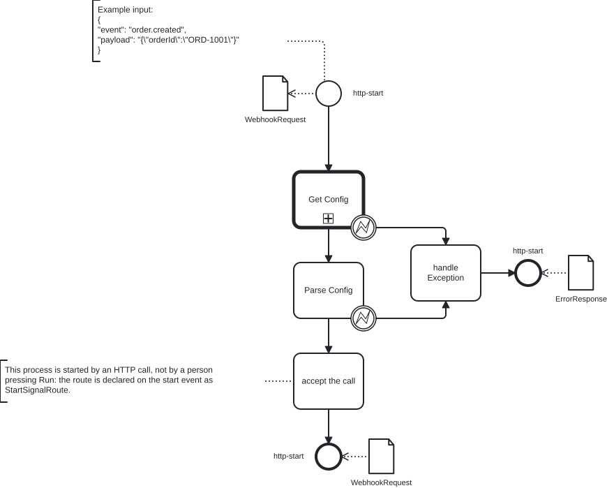

# 07 · What starts a process

A Flow does not have to wait for someone to press Run. Declaring a route on the
start event turns the model into an HTTP endpoint.

## What this example demonstrates

| Capability | Where to look |
|---|---|
| `StartSignalRoute` on the start event | the element parameter on `Ev_Start` |
| Choosing method and path | `{"method": "POST", "route": "webhook"}` |
| Escaping a C# keyword used as a field | `Input.@event` in `accept the call` (`T_Accept`) |
| The same typed boundary as any other Flow | the data elements on start and end |

## The model



```
start (POST /webhook) → Get Config → Parse Config → accept the call → end
                            ↓             ↓ (on error)
                            └─────────────┴──→ handle Exception → end
```

`Get Config` calls the Flow `bpmn-examples-config`: the file
[`03-config-as-flow/bpmn-examples-config.bpmn`](../03-config-as-flow/bpmn-examples-config.bpmn),
imported into the tenant library `bpmn_examples`.

The only difference from [01 · Basics](../01-basics/) is the parameter on the
start event. Everything downstream is unchanged — which is the point: how a Flow
is triggered is a property of its start, not of its body.

## Types it declares

| Type | Kind | How it is used |
|---|---|---|
| `WebhookRequest` | inner, JSON Schema | the process boundary. `event` names what happened, `payload` carries the detail |
| `ErrorResponse` | inner, JSON Schema | the shape of a failure |
| `ExternalConfig` | external | the configuration type |

`event` is a reserved word in C#. The declared field keeps its natural name, and
the code escapes it as `Input.@event`. Naming a field `type`, `class`, `base`,
`event` or `default` is legal in the schema and needs the `@` in every snippet
that touches it — one good reason to avoid such names when you can.

## What you should get back

Started directly, it echoes what it received:

```
{ "event": "order.created", "payload": "{\"orderId\":\"ORD-1001\"}" }   →   HTTP 200
{"event":"order.created","payload":"{\"orderId\":\"ORD-1001\"}"}
```

The run log carries `received 'order.created' on the declared route`.

Once the Flow is published as a plugin endpoint (designer: **Publish**), the
same process is also reachable at its declared route, and the caller does not
need to know the Flow's name or version. Publishing is described in the
[platform documentation](https://platform.mef.dev/plugin_basics/introduction.md).

## Why it is built this way

**The route lives on the diagram, not in a gateway configuration.** Reading the
model tells you how it is reached.

**The trigger changes nothing downstream.** The same Flow can be started by hand
during development and by a route in production, with no edit in between.

## Where newcomers stumble

- **The route is claimed at publication.** Two Flows declaring the same method
  and path collide; pick a path that names what it accepts.
- **A body is required.** An empty request answers `428 A non-empty request body
  is required` — send `{}` if there is nothing to say.

## Other triggers

This example starts on an HTTP route. A start by an event from a queue or by a
timer goes through ServiceHost and the message broker: compiling the Flow
registers its events, and ServiceHost calls the engine when one occurs. It is
described in the BPMN Low-Code guide, section *Event-based implementation:
ServiceHost and the message broker* (part of durable execution). See [BPMN Low-Code overview](https://platform.mef.dev/bpmn_lowcode/bpmn_lowcode_overview.md).

## Run it

Follow [Before you start](../README.md#before-you-start) for this file: IMPORT BPMN →
Save as into your Personal library → Compile → Publish into `bpmn_examples`.
Then Build → Execute → **Example** → Run: the input comes back. After Publish
as a plugin endpoint the same Flow answers on `POST …/webhook`.

---
For how the types in this example are designed, see [TYPE-DESIGN.md](../TYPE-DESIGN.md).
