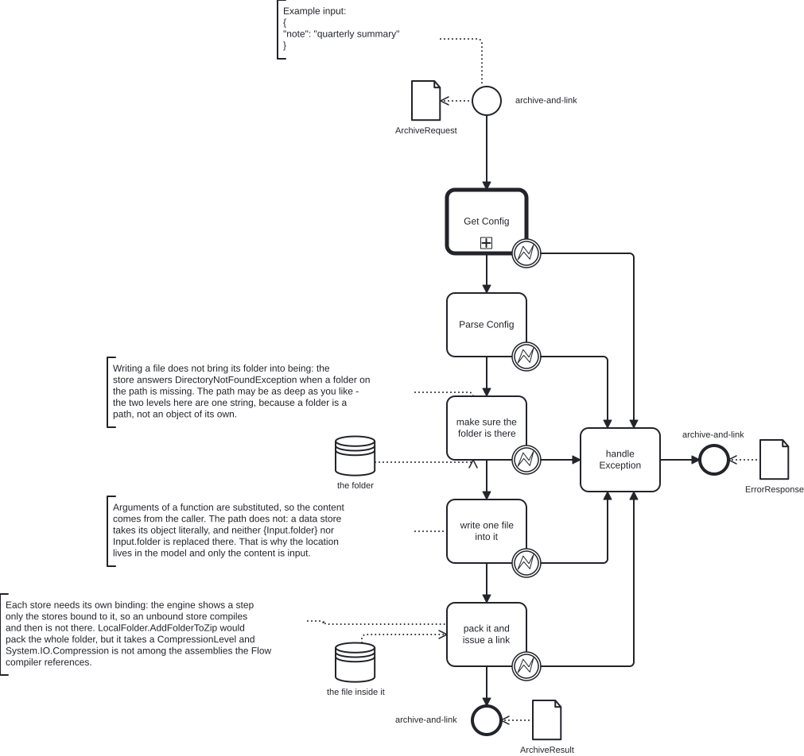

# 09 · Files, folders and a link to the archive

A file is not a variable. It lives in a store, it is reached through a binding
on the diagram, and what you hand back is a link — not the bytes.

## What this example demonstrates

| Capability | Where to look |
|---|---|
| A **Folder** data store | `the folder` (`DS_Folder`), `storeParameters` with `"type": "Folder"` |
| A **File** data store | `the file inside it` (`DS_File`), `"type": "File"` |
| Binding a store to the step that uses it | `dataInputAssociation` inside `make sure the folder is there` and `pack it and issue a link` |
| Creating a folder before writing into it | `make sure the folder is there` (`T_Folder`): `IsExists()` then `CreateFolder()` |
| A built-in that writes a file | `write one file into it` (`T_Write`): `actionType: Function`, `action: IO/Local/File` |
| Packing a file into a zip | `pack it and issue a link` (`T_Archive`): `GetFile().AddToZip("archive.zip")` |
| A download link the platform issues | `pack it and issue a link`: `archive.CreateLink()` |

## The model



```
start → Get Config → Parse Config → make sure the folder is there → write one file into it
                                     → pack it and issue a link → end

every step above, except start → handle Exception → end
```

`Get Config` calls the Flow `bpmn-examples-config`: the file
[`03-config-as-flow/bpmn-examples-config.bpmn`](../03-config-as-flow/bpmn-examples-config.bpmn),
imported into the tenant library `bpmn_examples`.

Two stores hang off the steps that use them: `the folder` off
`make sure the folder is there`, `the file inside it` off
`pack it and issue a link`.

## Types it declares

| Type | Kind | How it is used |
|---|---|---|
| `ArchiveRequest` | inner, JSON Schema | the process boundary; `Input.note` is the content to write |
| `ArchiveResult` | inner, C# class | what comes back: the folder and the link |
| `ErrorResponse` | inner, JSON Schema | the shape of a failure |
| `ExternalConfig` | external | the configuration type |

`LocalFolder` and `LocalFile` are not declared by you. They are what the store
bindings answer with: `DataAssociations.DS_Folder.GetFolder()` and
`DataAssociations.DS_File.GetFile()`.

## What you should get back

```
{ "note": "quarterly summary" }   →   HTTP 200

{"folder":"flow-patterns/archive-demo",
 "url":"https://<host>/s/tenant/21b744842fe98a2329ebd4cb422b21d8"}
```

The link is live: it carries its own authorisation, so it can be handed to
someone who has no session on the installation.

## Why it is built this way

**A folder is a path, not an object of its own.** There is no built-in
function for folders; `IO/Local/File` and `IO/Local/Archive` are the file
functions. Folders are created through the Folder store binding
(`IsExists()`, `CreateFolder()`). `flow-patterns/archive-demo` is one string,
two levels deep, and the store treats it as a folder because its `type` says
`Folder`.

**The folder is made before anything is written.** Writing does not bring a
missing folder into being; the store answers

```
DirectoryNotFoundException: Could not find a part of the path
'/storage/…/documents/tenant/flow-patterns/archive-demo/note.txt'
```

That is why `make sure the folder is there` comes first, and why it asks
`IsExists()` before calling `CreateFolder()`.

**A store's path is taken literally.** Substitution works in the arguments of a
function — `fileContent` here is `{Input.note}` and arrives filled in — but not
in a data store: a store path `{Input.x}` creates a folder literally named
`{Input.x}`. So the location lives in the model and only the content comes from
the caller.

**Every store is bound to a step.** The engine keeps only the stores that are
connected to the step by an input association. A store that nobody is bound to
compiles and then is not there — `DataAssociations` simply has no such member.

**The archive is made from the file.** `LocalFile.AddToZip(name)` is the
supported route: it takes only the archive name.

## Where newcomers stumble

- **Expecting `IO/Local/File` to answer with the file.** It writes and returns
  nothing. The next step reaches the file through its own store binding.
- **One property for two stores.** Each `dataInputAssociation` needs its own
  `__targetRef_placeholder` property; they cannot share one.
- **Sending the bytes back.** The result of the process is the link. A file
  travels as a link, not as a payload.

## Run it

Follow [Before you start](../README.md#before-you-start) for this file: IMPORT BPMN →
Save as into your Personal library → Compile → Publish into `bpmn_examples`.
Then Build → Execute → **Example** → Run with `{"note":"quarterly summary"}`: the
folder and a link to the archive come back. It needs no outbound access:
everything it touches is the installation's own document store.

---
For how the types in this example are designed, see [TYPE-DESIGN.md](../TYPE-DESIGN.md).
