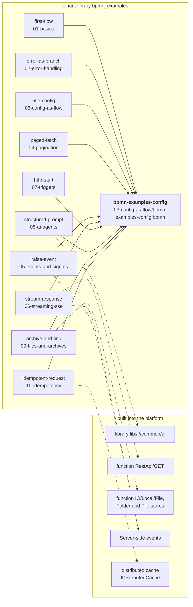

# Flow patterns

Teaching examples for the MEF.DEV platform, one problem per group. Each model
is small, commented on the diagram, and has been compiled and started on the
platform. The concepts behind them are described in the
[BPMN Low-Code overview](https://platform.mef.dev/bpmn_lowcode/bpmn_lowcode_overview.md).

## The groups

Ten groups, eleven models: group 03 has two.

| Group | The one thing it teaches | Model |
|---|---|---|
| [01 · Basics](01-basics/) | `Input` is the caller's payload, `#Previous` is the last step's result | `first-flow.bpmn` |
| [02 · Errors](02-error-handling/) | a failure is a branch: HTTP 500 and the text in the caller's language (`Accept-Language`, then the installation's language) | `error-as-branch.bpmn` |
| [03 · Configuration](03-config-as-flow/) | settings live in their own Flow, so a model never learns its environment | `bpmn-examples-config.bpmn` (required by every group), `use-config.bpmn` |
| [04 · Pagination](04-pagination/) | plan the pages first, then walk them with Multi Instance; on an API, `offset`/`limit` and `Content-Range` | `paged-fetch.bpmn` |
| [05 · Events](05-events-and-signals/) | a step can raise an event and keep working | `raise-event.bpmn` |
| [06 · Streaming](06-streaming-sse/) | read a response as it arrives, pass each chunk on | `stream-response.bpmn` |
| [07 · Triggers](07-triggers/) | the start event decides how a Flow is reached | `http-start.bpmn` |
| [08 · Agents](08-ai-agents/) | build a prompt as typed data, not as a string | `structured-prompt.bpmn` |
| [09 · Files](09-files-and-archives/) | a file lives in a store, and what you hand back is a link | `archive-and-link.bpmn` |
| [10 · Idempotency](10-idempotency/) | a repeated `x-ms-client-request-id` gets the stored answer from the distributed cache; HTTP 201, 400, 409, 503 | `idempotent-request.bpmn` |

**Before your first Flow**, read [TYPE-DESIGN.md](TYPE-DESIGN.md). Most errors
that look like a platform failure are a skipped type-design step.

## Before you start

### What you need

- An account on a MEF.DEV installation and access to the **BPMN designer**
  (`https://<host>/console/plugins/<plugin>/bpmn-designer/modeler`).
- The `.bpmn` files of this repository on your computer (clone it or download
  the files).
- For 06 · Streaming: the installation can reach the internet. The other groups
  need nothing outside the installation.

Every model is imported under its file name: `first-flow.bpmn` becomes the
Flow `first-flow`.

### Run an example, step by step

The steps use the designer's menus. Do steps 1–2 once; repeat steps 3–5 for
each example.

1. **Create the library.** File → Open → **CREATE NEW LIBRARY**.
   Library Name: `bpmn_examples`. Library Type: **Tenant Public** (not
   Personal). Create. The type is set only here; it cannot be changed later.
   Every model refers to `tenant/bpmn_examples`. In the Open window this
   library is listed as *(Shared)*.
2. **Import the configuration Flow first.** File → Open → **IMPORT BPMN** →
   choose `03-config-as-flow/bpmn-examples-config.bpmn`. File → **Save as**:
   Name `bpmn-examples-config`, Library `bpmn_examples`. Then Build →
   **Compile**: the Compile tab shows no errors. Every other model needs it, so
   it comes before them.
3. **Import the example.** File → Open → **IMPORT BPMN** → choose the example's
   `.bpmn` (for instance `01-basics/first-flow.bpmn`). File → **Save as**: Name
   = the file name without `.bpmn` (`first-flow`), Library `bpmn_examples`.
4. **Compile it.** Build → **Compile**: no errors. Save before you compile.
5. **Run it.** Build → **Debug** (Ctrl+D): enter the example input from the
   group's README and run. The designer shows the answer and the path the run
   took: one block per step on the Stage strip, with its result and duration.
   Build → **Execute** → **Parameters** → **Run** gives the answer only. The
   answer is the one under *What you should get back* in that README.

### If it does not compile

| Compile tab shows | Cause | Fix |
|---|---|---|
| `cant resolve class name for uri 'activities://bpmn-mnemo/tenant/bpmn_examples/bpmn-examples-config/#latest'` | `bpmn-examples-config` is not in a **Tenant Public** library named `bpmn_examples`, or it is not compiled | step 1 with type Tenant Public, then step 2 |
| `Error while forming alias 'ExternalConfig' for type 'types://external/ConfigActivity/Config'` | the same, seen from **Used libraries** | as above |
| `The type or namespace name 'OracleConfig' could not be found` | an older copy of `bpmn-examples-config.bpmn` | import the file from this repository again |

**Save as reports that the name is already used.** Flow names in Tenant Public
libraries are unique across the whole tenant: someone has already imported
`bpmn-examples-config` (or the example) into another library of your tenant.
Use that library, or the [other name](#a-library-with-another-name) steps below.

### A library with another name

Use a **Tenant Public** library. Each model refers to the configuration Flow in
**two** places; change both in every model you import, after step 3:

1. Workflow → **Used libraries** → row `ConfigActivity` → **Link**:
   `activities://bpmn-mnemo/tenant/<library>/bpmn-examples-config/#latest` →
   Save.
2. Select the step **Get Config** → Prop → CallActivity: tick **Mnemonic
   links**, then choose Library = your library, Flow = `bpmn-examples-config`,
   Version = `#latest`. Without **Mnemonic links** the designer writes a link
   with the numeric ids of one installation.

Then File → Save and Build → Compile.

A Personal library is not suitable for these examples: the platform resolves it
only for the account that created it.

## Which model depends on which

A solid arrow: the model calls `bpmn-examples-config` in its step `Get Config`
and takes the type `Config` from it, so `bpmn-examples-config` must be imported
and compiled first. No other model depends on another one: import any of them
alone after `bpmn-examples-config`. A dotted arrow: what the model uses from the
platform itself; nothing to import.

Why `bpmn-examples-config` comes first: every model begins with the step **`Get Config`**, a
Call Activity that calls the Flow `bpmn-examples-config`. Each model holds the
reference
`activities://bpmn-mnemo/tenant/bpmn_examples/bpmn-examples-config/#latest`; a
model compiles only when that Flow exists under exactly that library and name.

| You see | It is |
|---|---|
| `Get Config` | the step in every model that calls the configuration Flow |
| `bpmn-examples-config` | the configuration Flow: file `03-config-as-flow/bpmn-examples-config.bpmn` |
| `bpmn_examples` | the tenant library all models live in |
| `ConfigActivity` | the alias under which each model refers to `bpmn-examples-config` (`UsedLibs`) |
| `ExternalConfig` | in each model, the configuration type `Config` declared in `bpmn-examples-config` |

To use another library name, see
[A library with another name](#a-library-with-another-name).

## Terms

| Term | Meaning |
|---|---|
| Flow | a BPMN model the platform compiles and runs |
| installation | one deployment of the MEF.DEV platform |
| tenant library | a library shared by every account of the tenant; Flows find each other there by name |
| Call Activity | a step that runs another Flow and returns its answer |
| `Input` | the request payload the Flow was started with |
| `#Previous` | the result of the step just before |
| `#PreviousData` | what the engine hands to an error handler: the failed step's exception |
| `Parameters` | variables that live for one run of the Flow and are visible to every step |
| boundary error event | the small circle on a step's edge; when the step fails, the run follows its arrow |
| Code Action | a C# function declared once in the model and called from its steps |
| Multi Instance | a Sub Process run once per element of a collection |
| published plugin | a Flow published as an HTTP endpoint of a plugin |
| `UsedLibs` | the model's list of other Flows and libraries it refers to, each under an alias |

## What the examples talk to

Two public sources, no key, no account, nothing to expire:

| Source | Used for |
|---|---|
| `api.frankfurter.dev` | exchange rates published by the European Central Bank |
| `jsonplaceholder.typicode.com` | a list endpoint that understands `_start` and `_limit` |

`login` and `password` in the configuration are empty, because neither source
needs them. A real deployment fills them in that one file.

Compiling never touches the network. Running the examples that make an outbound
call does: without a route to the internet those runs end on the error branch,
which is the correct behaviour and is shown in the group's README.

## Expected results

Each model started with its example input answers:

| Model | Input | Result |
|---|---|---|
| `first-flow` | `{"name":"Ada","language":"en"}` | `{"name":"Ada","language":"en"}` |
| `error-as-branch` | `{"orderId":"ORD-1001"}` | `{"orderId":"ORD-1001"}` |
| `error-as-branch` | `{"orderId":""}`, `Accept-Language: uk` | HTTP 500, `ErrorResponse` with `"message":"Потрібно вказати orderId"` |
| `bpmn-examples-config` | `{}` | the settings object (`Config`) |
| `use-config` | `{"key":"EUR"}` | `{"key":"https://api.frankfurter.dev/v1/latest?base=EUR"}` |
| `paged-fetch` | `{"total":25}` | three `PageInfo` entries, the third for rows 21–25 — one Sub Process instance each, two at a time |
| `http-start` | `{"event":"order.created",…}` | the request echoed back |
| `structured-prompt` | `{"question":…,"tone":"plain"}` | two typed chat messages |
| `raise-event` | `{"jobId":"JOB-7"}` | `{"jobId":"JOB-7"}`, with a progress event per part |
| `stream-response` | `{"topic":"USD"}` | `{"topic":"USD"}`, every line passed on through `Event_Chunk` |
| `archive-and-link` | `{"note":"quarterly summary"}` | the folder and a link to the archive |
| `idempotent-request` | `{"orderId":"ORD-1001","amount":25.5}`, `x-ms-client-request-id` | first call: HTTP 201, `cacheStatus` `Added`; the same id again: HTTP 201, the same `confirmation`, `cacheStatus` `IsCompleted`; no header: HTTP 400 |

Two conditions are outside the diagrams:

- **An outbound call needs a route to the internet.** Without one the call
  fails and the error branch answers.
- **`AI/Completions` needs a chat model installed on the installation itself.**
  Without one, the call ends on the error branch.
  [08 · Agents](08-ai-agents/) therefore stops at building the request.

## How to read a group

Each group's README says the same four things:

- **what capabilities the example demonstrates**, and where in the file to look;
- **which types it declares** and how each one is used;
- **what you should get back** for the example input;
- **why it is built that way**, and where newcomers usually trip.

## The file beside each model

Next to every `<name>.bpmn` lies `<name>.spec.json`: the model's intent — the
input and its example, each step with the comment that explains it, the stores,
the outcomes and their examples. The models were generated from these
specifications; `bpmn-examples-config.bpmn` is kept by hand (`"generate": false`). Read the specification
when you want the decisions without the diagram around them.
